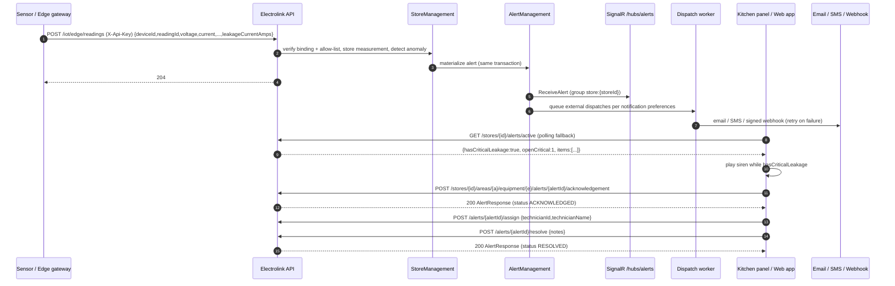
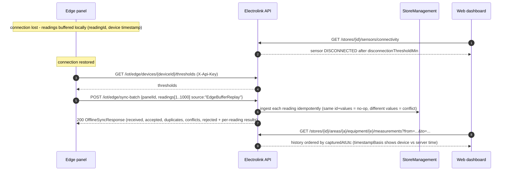
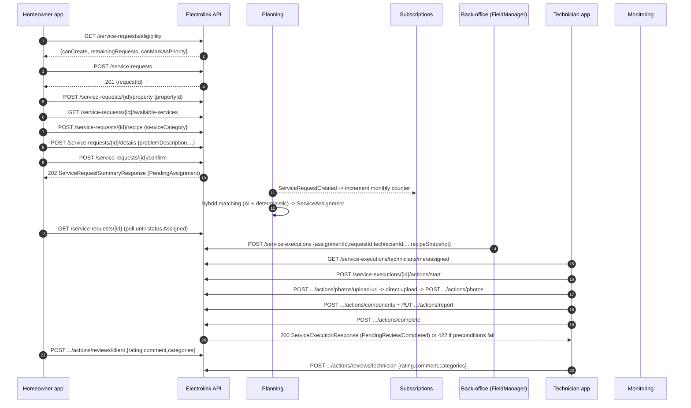

# Operational flows (sequence diagrams)

Diagrams are Mermaid `sequenceDiagram`s; all REST paths are relative to `/api/v1`.

## 1. Sign-up, profile completion and token refresh

```mermaid
sequenceDiagram
    autonumber
    participant UI as Web/Mobile app
    participant API as Electrolink API
    participant IAM as IAM
    participant PRO as Profiles
    participant AST as Assets
    participant SUB as Subscriptions

    UI->>API: POST /auth/sign-up {email,password,passwordConfirmation,role:"User"}
    API->>IAM: create User (role User) + refresh token
    IAM-->>PRO: UserRegisteredEvent -> Incomplete profile
    API-->>UI: 201 {userId,email,token,refreshToken}
    UI->>API: POST /profiles/me/complete/homeowner (Bearer token)
    API->>PRO: validate + activate profile (ProfileCompletedEvent)
    API-->>UI: 201 MyProfileResponse + X-Refreshed-Token header
    PRO-->>AST: ProfileCompletedEvent -> create portfolio / inventory
    PRO-->>SUB: ProfileCompletedEvent -> BASIC subscription
    Note over UI,API: UI replaces its access token with X-Refreshed-Token (profileId, businessRole, roleSubjectId, subscriptionTier). Older tokens still work: claims are re-read server-side.
    Note over UI,API: Access token lives 20 min; refresh ~60 s before exp
    UI->>API: POST /auth/refresh {refreshToken}
    API->>IAM: validate hash, mark used, issue new pair
    API-->>UI: 200 {token, refreshToken}  (old refresh token is now invalid)
    UI->>API: POST /auth/refresh {old refreshToken}
    API-->>UI: 401 (reuse detected) -> clear session, go to sign-in
```

## 2. Password recovery

```mermaid
sequenceDiagram
    autonumber
    participant UI as Web app
    participant API as Electrolink API
    participant SMTP as SMTP / log
    actor U as User mailbox

    UI->>API: POST /auth/forgot-password {email}
    API-->>UI: 200 {message} (always, no enumeration)
    API->>SMTP: email with {PasswordReset:FrontendUrl}/reset-password?token=...
    SMTP-->>U: message (only if SMTP is configured; otherwise logged on the server)
    U->>UI: opens link (token valid 15 min, single use)
    UI->>API: POST /auth/reset-password {resetToken,newPassword,newPasswordConfirmation}
    API-->>UI: 200 {message:"Password reset successfully."} (all sessions revoked)
    UI->>API: POST /auth/sign-in
```

## 3. Critical alert on kitchen equipment (telemetry → alert → notification → response)



## 4. Offline edge buffer and batch synchronisation



## 5. Service request → matching → execution → completion



## 6. Subscription checkout (Stripe) and webhook

```mermaid
sequenceDiagram
    autonumber
    participant UI as Web app
    participant API as Electrolink API
    participant ST as Stripe
    participant SUB as Subscriptions

    UI->>API: POST /subscriptions/checkout {planType,billingCycle,successUrl,cancelUrl}
    API->>ST: create Checkout Session
    API-->>UI: 200 {checkoutUrl,sessionId}
    UI->>ST: redirect to checkoutUrl (hosted page)
    ST-->>UI: redirect to successUrl (NOT proof of payment)
    ST->>API: POST /webhooks/stripe  invoice.payment_succeeded  (Stripe-Signature)
    API->>SUB: verify signature, idempotent inbox, activate PREMIUM
    API-->>ST: 200
    loop every 2 s up to 30 s
        UI->>API: GET /subscriptions/me
        API-->>UI: {planType,status}
    end
    Note over UI,API: No refresh-claims needed: the server re-reads subscriptionTier (cache up to 30 s)
    Note over ST,SUB: invoice.payment_failed -> GRACE_PERIOD (7 days); UI shows GET /subscriptions/me/status-alert
```
